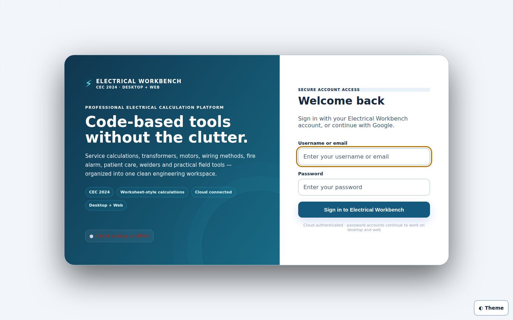
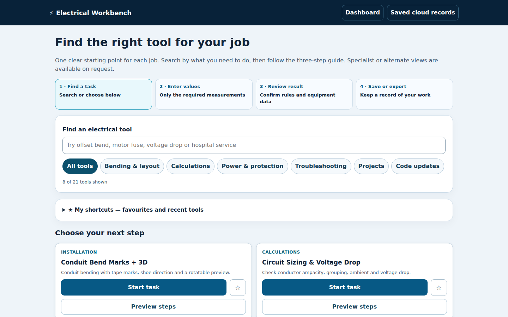
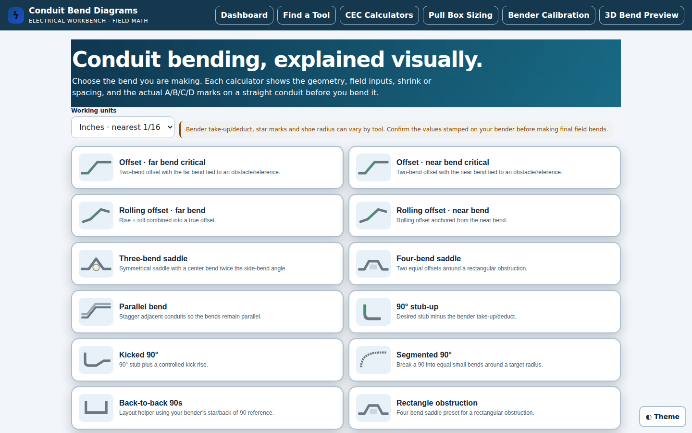
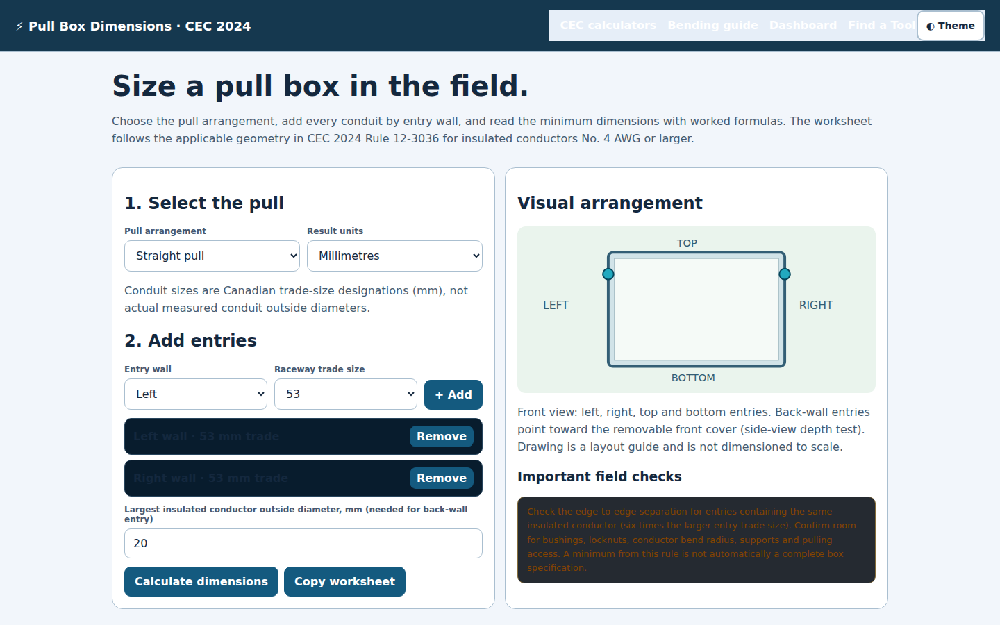
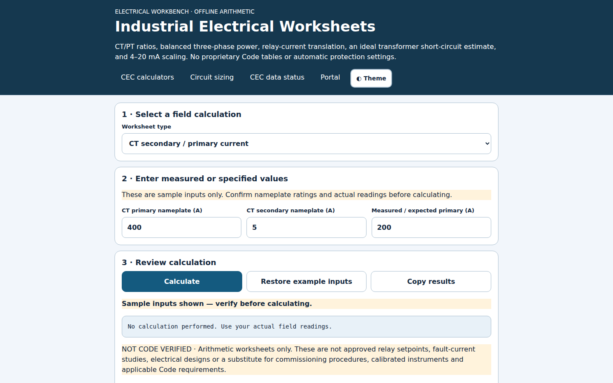

# ⚡ Electrical Workbench

**Practical electrical calculation, conduit-layout, commissioning and project tools for electricians, apprentices, electrical technologists and field teams.**

Electrical Workbench combines a **Spring Boot web portal** with native **Android (Kotlin/Compose), Windows (JavaFX)** and developing **iPhone/iPad (SwiftUI)** clients. It is designed around a simple field workflow: **find a task → enter measurements → review the result → save or export**.

[**Open web portal**](https://remote-javafx-portal.onrender.com) · [**GitHub releases**](https://github.com/GFH-GhostsFromHell/jhipster-javafx-remote-platform/releases) · [**Builds & downloads**](https://github.com/GFH-GhostsFromHell/jhipster-javafx-remote-platform/actions) · [**Development roadmap**](docs/PRODUCTION_HARDENING_ROADMAP.md)

> [!IMPORTANT]
> **Active development / not Code-certified.** The project includes CEC 2024 / Ontario-oriented workflows, but numerical Code tables, installation assumptions, field measurements and safety-critical outputs have **not been independently verified for compliance**. Check the current official CEC, applicable Ontario amendments, equipment specifications, and authority having jurisdiction. Do not use generated results as a substitute for qualified design, inspection or protection studies.

## See the application

These are **real browser screenshots of the HTML/JavaScript shipped in this repository**, captured locally at a desktop viewport by [the screenshot workflow](.github/workflows/capture-readme-screenshots.yml). They show the interface without an authenticated account or live backend; they are **not evidence that production deployment or every calculation is working**.

| Welcome and account sign-in | Find a Tool — task-based navigation |
|:--:|:--:|
|  |  |

| Conduit Bend Marks | Pull Box Sizing |
|:--:|:--:|
|  |  |



*To refresh the captures when the UI changes, run **Capture README web UI screenshots** in GitHub Actions. Do not use production credentials or customer records when capturing previews.*

## What it does

| Area | Examples of available tools |
| --- | --- |
| **Electrical calculations** | Voltage drop, conductor/circuit review, transformer and motor arithmetic, load and service worksheets, power factor, capacitors, welders, refrigeration, and installation-related inputs |
| **Conduit bending** | Stub-up and back-to-back 90s, offsets, rolling offsets, saddles, bend gain and shrink, bender calibration, tape/arrow reference marks, worked instructions and browser-based visual/3D views |
| **Jobsite tools** | Straight, angle, U and back-wall pull-box sizing; material takeoffs, quoting, commissioning notes, job records and worksheet exports |
| **Industrial & protection** | CT/PT ratio and current translation, three-phase power, idealized transformer fault-current arithmetic, 4–20 mA scaling and relay-related field worksheets |
| **Troubleshooting** | Equipment troubleshooting knowledge base and structured fault-isolation guidance |
| **Projects & saved work** | Local records, supported authenticated cloud-synced structured records, worksheet revisions, conflict-aware restoration and PDF/JSON exports where available |
| **Study & reference** | Red Seal/309A-style practice, formula references, CEC section navigation, code updates and technical learning tools |
| **Account management** | Cloud sign-in, feature entitlements, subscription/tier management and administrative tools |

**Feature coverage differs by platform and subscription tier.** Some tools run natively without internet; others open the hosted web portal and require sign-in/network access. Saved local drafts, device settings and cloud records are not always interchangeable. See [cross-platform account sync](docs/CROSS_PLATFORM_ACCOUNT_SYNC.md) and the [navigation standard](docs/UX_NAVIGATION_STANDARD.md).

### Built for field use

- **Task-first navigation:** search for actions such as “offset bend,” “motor fuse,” “voltage drop” or “hospital service” rather than knowing internal menu names.
- **Fast measurements:** minimize unnecessary fields; show result, marking positions, units, assumptions and warnings.
- **Online and offline modes:** common native calculations remain available offline; advanced web tools and account sync require connectivity.
- **Preserved work:** supported worksheet and project revisions can be reviewed and exported, with explicit re-calculation requirements for stale results.
- **Practical engineering boundaries:** user-entered nameplate data, bend-shoe calibration and code verification remain essential.

## Platforms and downloads

| Platform | Availability / getting started | Notes |
| --- | --- | --- |
| **Web portal** | [Open hosted portal](https://remote-javafx-portal.onrender.com) or [web source](portal/) | Spring Boot app with browser worksheets and account services. Hosted deployment may be behind `main`; check the [production release runbook](docs/PRODUCTION_RELEASE_RUNBOOK.md). |
| **Android** | [Android build workflow](.github/workflows/build-android-client.yml) / [workflow runs](https://github.com/GFH-GhostsFromHell/jhipster-javafx-remote-platform/actions/workflows/build-android-client.yml) | Native Kotlin/Compose client. Download the `ElectricalWorkbench-Android` APK artifact from a **successful** run. A debug CI APK is not equivalent to a persistently signed update. Android 8.0+ (API 26). |
| **Windows** | [Desktop build workflow](.github/workflows/build-desktop-client.yml) / [releases](https://github.com/GFH-GhostsFromHell/jhipster-javafx-remote-platform/releases) | JavaFX app; successful workflow runs produce `RemoteJavaFXClient-Windows` with an MSI. Review the build and release before installing. |
| **iPhone/iPad** | [iOS source and build guidance](ios-client/README.md) / [simulator workflow](.github/workflows/build-ios-client.yml) | SwiftUI client for iOS 17+. Simulator builds exist, but **no public App Store installation is claimed**; physical device use requires Apple code signing. |

**Downloading a GitHub Actions artifact:** open the workflow run, confirm it succeeded, scroll to **Artifacts**, download the named ZIP, and extract the installer/APK. GitHub sign-in may be required and artifacts have retention limits. Check installer signatures and release notes before installing.

### Web quick links

- [Find a Tool](https://remote-javafx-portal.onrender.com/start.html) — task search and shortcuts
- [Conduit bending](https://remote-javafx-portal.onrender.com/bend-calcs.html) — measurements, marking and visual guidance
- [Pull-box sizing](https://remote-javafx-portal.onrender.com/pull-box-calcs.html) — straight, angle, U and back-wall pulls
- [Industrial worksheets](https://remote-javafx-portal.onrender.com/industrial-commissioning.html) — CT/PT, three-phase and analog scaling
- [Troubleshooting knowledge base](https://remote-javafx-portal.onrender.com/troubleshooting-kb.html) — field fault-isolation guidance

*The hosted service may require an account, may restrict access by tier, and can lag behind the GitHub branch.*

## Technology

```text
                        Electrical Workbench
                                 |
             +-------------------+-------------------+
             |                   |                   |
       Android client      Windows client      iPhone/iPad client
       Kotlin / Compose      Java / JavaFX           SwiftUI
             |                   |                   |
             +-------------------+-------------------+
                                 |
                    HTTPS + authenticated APIs
                                 |
                 Spring Boot web portal / browser UI
                                 |
                      PostgreSQL / local H2
                                 |
                    Render deployment tooling
```

### Repository layout

```text
android-client/      Native Android application and tests
desktop-client/      Windows JavaFX application
ios-client/          Native SwiftUI project and iOS guidance
portal/              Spring Boot API, web pages, calculators and account services
jhipster/            JDL/schema starter for future JHipster evolution
docs/                UX, safety, audit, sync and release documentation
scripts/             Automated validations, smoke checks and screenshots
.github/workflows/   Android, Windows, iOS, portal, QA and release CI
render.yaml          Render service/database deployment specification
```

The separate [**Device Security Center**](https://github.com/GFH-GhostsFromHell/device-security-center) has its **own repository**. It is not part of the main Electrical Workbench installation.

## Developer quick start

**Prerequisites:** JDK 21 and Maven for the Java projects; Android SDK/API 36 and Gradle for Android; macOS/Xcode and XcodeGen for iOS. Cloud features require appropriately configured server/database environment variables and test accounts.

```bash
git clone https://github.com/GFH-GhostsFromHell/jhipster-javafx-remote-platform.git
cd jhipster-javafx-remote-platform

# Spring Boot portal tests and local launch
mvn -B -f portal/pom.xml test
mvn -f portal/pom.xml spring-boot:run

# JavaFX desktop app: build JAR and dependencies
mvn -B -f desktop-client/pom.xml clean package

# Android: from the android-client directory (with Gradle and Android SDK configured)
cd android-client
gradle :app:testDebugUnitTest :app:assembleDebug
```

For iOS, see [iOS build instructions](ios-client/README.md). For production configuration, authentication, Render and CI release checks, see the [production release runbook](docs/PRODUCTION_RELEASE_RUNBOOK.md). **Never commit secrets, database contents, encryption keys or real user information.**

## Accuracy, testing and release status

Electrical Workbench includes automated arithmetic, navigation, data integrity and workflow checks, **but a passing CI build is not a field acceptance test or a CEC/OESC compliance approval**.

In particular:

- The CEC 2024 numeric reference register still identifies important licensed-table values as **pending authorized source verification**. Do not infer a verified ampacity, conductor selection or OCPD size from a generic worksheet.
- Power system and relay results are **worksheet estimates** based on supplied assumptions; they are not short-circuit/arc-flash studies, protection coordination or relay setting approvals.
- Real-device testing is still required for mobile screen sizes, bending-shoe geometry, offline behavior, app signing, accessibility and account synchronization.
- Hosted production health and the exact deployed commit must be checked independently; build success does not prove production deployment or sign-in functionality.

See [CEC data audit](docs/CEC2024_CONDUCTOR_DATA_AUDIT.md), [industrial calculator limitations](docs/INDUSTRIAL_FIELD_CALCULATORS_AUDIT.md), [production hardening roadmap](docs/PRODUCTION_HARDENING_ROADMAP.md), and [release verification](docs/PRODUCTION_RELEASE_RUNBOOK.md).

## Project status and feedback

This is an evolving multi-platform electrical field toolkit, not an officially endorsed or certified Code product. Source changes and bug reports can be opened in [GitHub Issues](https://github.com/GFH-GhostsFromHell/jhipster-javafx-remote-platform/issues). For calculation defects, include the task, input values, expected formula/source, actual result, affected platform and app/build version. **Avoid attaching private jobsite information or credentials.**
